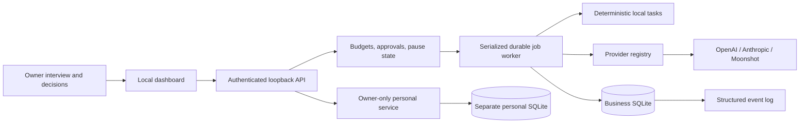

# Architecture

The renderer displays a local React/TypeScript dashboard. It has no direct filesystem or Node access. An Express loopback service owns the data and every state change. Electron starts that service with a random session capability and opens the compiled UI. The same service supports local browser development.

## Modules

| Module | Responsibility |
| --- | --- |
| `server/storage.mjs` | SQLite setup, transactions, audit hashes, events |
| `server/validation.mjs` | Owner, money and record boundary validation |
| `server/hub.mjs` | Owner profile, agent configuration, settings, personal service, reports |
| `server/finance.mjs` | Integer-cent ledger, CSV parsing, P&L and tax estimate |
| `server/orchestrator.mjs` | Queue, routing, budget reservation, pause, recovery and approval versions |
| `server/business-context.mjs` | Explicit business-field allowlist and confirmed owner constraints in cloud prompts |
| `server/launch.mjs` | Versioned launch direction, atomic three-job batches, dependency checks and exact review packs |
| `server/providers.mjs` | Provider request/response contracts, token pricing, session key vault |
| `server/app.mjs` | Authenticated HTTP interface, origin/host checks and exports |
| `electron/main.cjs` | Desktop lifecycle, OS-encrypted key storage and isolated renderer |
| `config/agents.json` | Sixteen roles, permissions, triggers, escalation, ceilings and KPIs |
| `config/playbooks.json` | Six business models and adapted duties |

## Task lifecycle

The owner confirms the interview before tasks or provider connections are accepted. A unique request ID creates a queued job and event. The worker runs jobs one at a time, so budget checks and reservations cannot race. A deterministic task returns local calculations with zero model tokens. A cloud task chooses the least expensive enabled, connected provider for the requested tier.

The cloud path uses the agent mission, an explicit allowlist of business interview fields, Brand Bible and task. The allowlist includes confirmed weekly hours, experience, currency, income target, startup/operating/API budgets and the hard spending cap. It does not spread arbitrary profile properties. Prompts assign operational work to agents, reserve the owner's time for ideas and review, and identify unavailable connections. Model instructions do not enforce actual owner time or output correctness. The worker has no tool calls, credentials in prompts, personal journal access, or execution permissions. An exact cache match returns without a paid call; changed business constraints invalidate that match. Otherwise, the worker reserves a conservative input-byte/output-token cost estimate and agent token allowance inside a database transaction. It checks the monthly API, operating and hard limits before dispatch.

Known usage settles the reservation and records an API expense estimate. Anthropic cached input tokens count toward usage; pricing conservatively includes cache-write overhead. Incomplete/truncated responses settle known usage, fail visibly and never enter the completed cache. Network failures, missing usage and interruption retain the maximum reservation as unknown. The owner records the provider billing outcome in Finance to release it. The app does not retry paid requests automatically.

At 80% of a token limit, a premium task downgrades to routine and informs the Manager through an event. At 100%, cloud work blocks and creates a budget review card. This release has no deterministic substitute for arbitrary writing. Local tasks remain available.

Ten completed jobs of an agent/type create a distillation-candidate event. This count is not a public-action success score. Earned autonomy requires later execution adapters and an audited success track record.

## Launch workspace

The owner explicitly saves an audience, transformation, offer format and content preference. Optimistic versions reject stale edits; saving never generates text. A separate request atomically queues three private draft jobs: Research prepares the offer brief, the Content Strategist prepares the starter asset, and the Manager prepares landing-page copy and three welcome emails. Later stages receive only completed earlier drafts, labeled as untrusted content. An incomplete, failed or blocked prerequisite stops dependent work before provider transport.

The batch, direction, job links and request replay mapping persist in the business database. Duplicate delivery of the same request returns its original batch. Another request cannot overlap active launch work or bypass an unresolved billing outcome from the previous batch. Each stage uses the existing serialized worker, budget reservations, agent enablement and pause controls. There is no automatic paid retry or scheduled launch.

A saved direction or owner business change makes the current pack outdated. Queued stages block before a provider call, while an already dispatched request may still complete and incur a charge. Outdated packs cannot be submitted for review. After all three stages complete, one idempotent action copies their exact text into the central Approvals queue. Oversized packs are rejected rather than truncated. Approval remains `connection_required`; it creates no page, email, booking, checkout or delivery. Future adapters require approval of the actual external action and execution receipts.

## Approvals and recovery

An approval includes who, what, why, cost, risk, expected outcome, recommendation and exact content. Its version must match the decision. Editing increments the version, returns the card to pending and invalidates earlier authorization. Guardian may veto. Budget approval never raises a limit by itself, and a publishing approval never claims content was posted.

Pause persists and aborts the active provider request. Resume drains queued work. Restart marks interrupted jobs failed and exposes their retained reservations for reconciliation. Queued jobs can resume; paid jobs with unknown outcomes never replay automatically. Settings and local records remain accessible while paused.

## Data and privacy

`business.sqlite` stores profile, settings, agent overrides, jobs, approvals, events, usage, cache, time records, finance and audit. `personal.sqlite` stores only private interview answers and notes. The business state endpoint, business prompts, audit, evidence export and business backup exclude personal content. Personal exports require an explicit owner action.

This is a single-owner application. Privacy enforcement applies to the app's agent and API boundaries. Databases are not encrypted at rest; the OS account and disk encryption protect local files. A machine administrator can inspect or rewrite local data. The audit hash chain detects changed entries but is not an external proof of immutability or income.

Desktop keys use Electron `safeStorage`. On Linux, an insecure `basic_text` backend triggers session-only storage. Browser development always uses session-only provider secrets. The renderer stores only its random app-session capability, never API keys. Backups exclude provider keys. No configured credential was read or reused during this build.

The server binds to 127.0.0.1, rejects non-loopback Host headers and foreign Origins, and requires a session bearer capability. Desktop bootstrap is disabled. Development bootstrap requires a custom header and relies on same-origin browser access checks. CSP blocks remote scripts, fonts, frames and connections from the renderer. Fonts are bundled. Electron denies permission requests, new windows and remote navigation.

## Explicit extension points

Agent definitions and playbooks are JSON. Adding a provider requires one adapter in the provider module, its editable model/rate definition and contract tests. Business tools should be separate adapters with explicit per-agent permissions, immutable approval payloads, external idempotency keys and verified execution receipts. The first live adapter is the next milestone; installing a chat plugin does not authorize or create an integration inside the standalone app.
